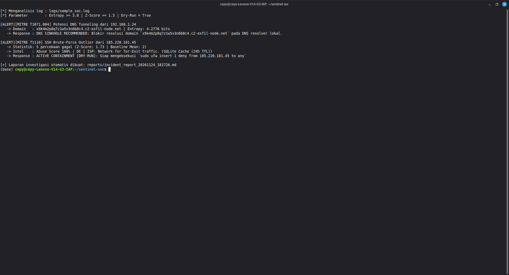

# SENTINEL — CLI SOC Triage & Anomaly Detection Engine

A modular Python and SQLite3 prototype for analyzing Linux authentication (`auth.log`) and DNS query logs. I built this project to explore how statistical thresholds and local API caching can filter noisy log events before escalating alerts for incident response.

## How It Works

1. **Log Parsing (`main.py`):** Extracts failed SSH login attempts and DNS queries using compiled regular expressions and stores normalized authentication events in SQLite (`sentinel.db`).
2. **Statistical & Entropy Filtering (`anomaly_engine.py`):**
   - **DNS Tunneling (`MITRE T1071.004`):** Calculates Shannon Entropy ($H(X) = -\sum P(x_i)\log_2 P(x_i)$) on the leftmost DNS label. Includes a suffix allowlist for common cloud/CDN providers (`.cloudfront.net`, `.googleapis.com`, etc.) to suppress benign high-entropy hostnames.
   - **SSH Brute-Force (`MITRE T1110`):** Computes the Z-Score ($Z = \frac{x - \mu}{\sigma}$) across failed login counts per source IP to separate automated credential stuffing from isolated user typos.
3. **Threat Intel & Caching (`threat_intel.py`, `database.py`):** Queries the AbuseIPDB v2 API for outlier public IPs and caches responses in SQLite for 24 hours (`ip_cache` table) to preserve free-tier API quotas.
4. **Safe Containment & Reporting (`responder.py`):** Checks RFC1918 private ranges via `ipaddress` so internal hosts are never blocked at the firewall level, prepares `ufw` deny rules (defaulting to `--dry-run`), and outputs Markdown incident reports in `reports/`.

## Usage

~~~bash
git clone https://github.com/cepyhs/sentinel-soc.git
cd sentinel-soc

# Optional: enable live AbuseIPDB enrichment
export ABUSEIPDB_API_KEY="your_api_key"

# Run against sample telemetry
python3 main.py --log logs/sample_soc.log --entropy 3.8 --z-threshold 1.5

# Run against system SSH logs on Linux
python3 main.py --log /var/log/auth.log
~~~

## Threshold Tuning Notes

- During local testing, a raw Shannon Entropy threshold of `3.8` flagged legitimate CDN subdomains (`d3k9x7m2p4q8w1.cloudfront.net` scored `3.8074` bits). Adding known infrastructure suffixes eliminated those false positives without raising the global threshold and missing shorter exfiltration payloads.
- Requiring both `attempts >= 5` and `Z-Score >= 1.5` prevents single-user password mistakes from triggering alerts when overall log volume is low.

## Known Limitations

- **Batch Processing Only:** Currently reads static log files on demand rather than tailing logs continuously (`--watch` daemon mode).
- **Single-Host Scope:** Designed for single-node Linux log triage rather than distributed log ingestion.
- **Static CDN Allowlist:** Relying on domain suffixes does not cover self-hosted services that legitimately use UUID subdomains; future iterations should incorporate historical domain frequency baselines.
